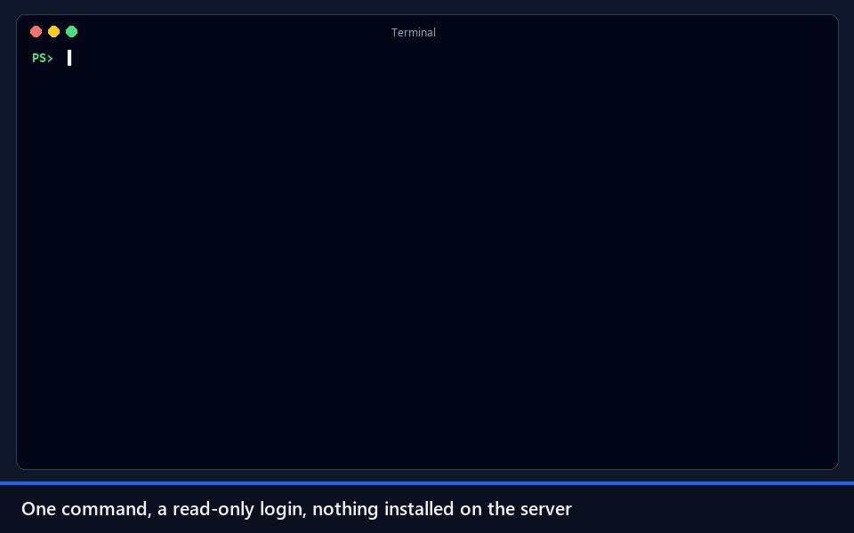
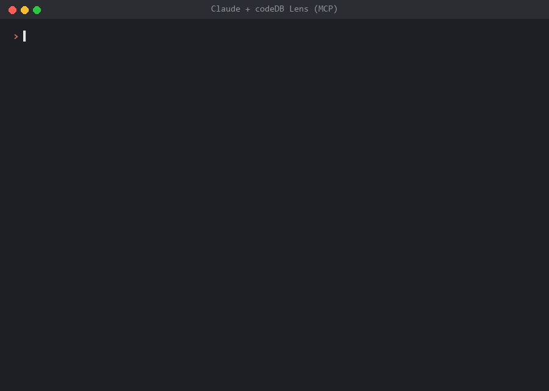

<h1 align="center">
  <picture>
    <source media="(prefers-color-scheme: dark)" srcset="assets/icon/logo-dark.svg">
    
  </picture>
</h1>

<p align="center">
  <b>See what your database isn't showing you.</b><br>
  Free, read-only health check for <b>SQL Server</b> and <b>PostgreSQL</b>.
</p>

<p align="center">
  <a href="https://app.codedb.com.br/lens?utm_source=lens&utm_medium=github">Website</a> · English · <a href="README.pt-BR.md">Português (Brasil)</a>
</p>

<p align="center">
  <a href="https://github.com/codedb-io/codedb-lens/releases/latest"></a>
  <a href="LICENSE"></a>
  
  
  <a href="https://github.com/codedb-io/codedb-lens/actions/workflows/ci.yml"></a>
</p>

<p align="center">
  <a href="https://lens.codedb.com.br/demo/report.html"></a><br>
  <sub>Real run against a test SQL Server (host renamed). <a href="https://lens.codedb.com.br/demo/report.html">Open a demo report</a>.</sub>
</p>

---

> **v0.8:** `check` (with an executive summary and `--redact` for sharing), `compare`, and `record` + `report` to watch an instance for up to 24 hours ([how](https://lens.codedb.com.br/record/)). 26 rules plus 8 for recordings. FAQ and more on the [website](https://app.codedb.com.br/lens?utm_source=lens&utm_medium=github).

codeDB Lens connects to your instance with a **read-only** login, runs a catalog of evidence-based
rules and writes a self-contained HTML + JSON report with an **A–F grade** and a **coverage seal**
(the share of rules that could actually run). Nothing about your database leaves your machine.

## Install

| Where | How |
|---|---|
| **Windows** | [Installer (per user, no admin)](https://github.com/codedb-io/codedb-lens/releases/latest/download/codedb-lens_windows_amd64_setup.exe) or [portable .zip](https://github.com/codedb-io/codedb-lens/releases/latest/download/codedb-lens_windows_amd64.zip) |
| **Windows (Scoop)** | `scoop bucket add codedb https://github.com/codedb-io/codedb-lens` then `scoop install codedb/codedb-lens` |
| **Linux** | `.deb` / `.rpm` from the [latest release](https://github.com/codedb-io/codedb-lens/releases/latest), or the tarball for [x64](https://github.com/codedb-io/codedb-lens/releases/latest/download/codedb-lens_linux_amd64.tar.gz) / [arm64](https://github.com/codedb-io/codedb-lens/releases/latest/download/codedb-lens_linux_arm64.tar.gz) |
| **Docker** | `docker run --rm -e PG_DSN -v "$PWD:/out" ghcr.io/codedb-io/codedb-lens check --engine pg --dsn-env PG_DSN --out /out` |

The Windows binaries are open source but not code-signed yet, so SmartScreen may show a warning.
[Why, and how to verify the download](https://lens.codedb.com.br/windows-warning/).

## Why another tool?

- **Evidence, not opinions.** Every finding shows the collected values, the query that produced them and when.
- **Honest confidence.** Each finding is *Confirmed*, *Hint* or *No data*. A rule that lacks permission
  never shows up as a false "OK"; it lowers the coverage instead.
- **Read-only, always.** No DDL, no DML, no agent, no installation on the server.
- **Rules are data.** Each rule is a YAML file plus a SQL query. Contributions don't touch the engine.
- **English and Portuguese (Brazil)**, in the app, the CLI and the report.

## What it checks

| SQL Server | PostgreSQL |
|---|---|
| Missing or old backups | Version out of support |
| No recent clean DBCC CHECKDB | pg_stat_statements not available |
| Failing SQL Agent jobs | A single query dominating execution time |
| Disk or transaction log running out of space | Long and idle-in-transaction sessions |
| Dominant waits, translated | Sessions blocked by locks |
| Sessions blocked right now | Transaction ID wraparound risk |
| A single query dominating CPU | Dead rows and autovacuum falling behind |
| Instance settings left at defaults | Replication slots retaining WAL, replica lag |
| TempDB file layout | Connections near the limit, no pooler |
| Version out of support | Unused, duplicate and invalid indexes |
| High-impact missing indexes | Estimated table bloat |
| Unused and duplicate indexes | Largest tables |

Each rule has a [documentation page](docs/en/rules/) with what it checks, why it matters, what to do and its limits.

## Quick start

On Windows, open **codeDB Lens** from the Start menu. Pick the engine, enter the server and run the diagnosis.
Connection profiles are saved; passwords go to the Windows Credential Manager.

Command line (Windows and Linux):

```bash
codedb-lens check --engine mssql --server prod01 --auth windows
codedb-lens check --engine pg --dsn-env PG_DSN
```

Passwords are never accepted as command-line arguments. Use integrated auth, an environment variable or a saved profile.

## Use with AI (MCP)

<p align="center">
  <br>
  <sub>Real Claude Code sessions against test databases; answers shortened.</sub>
</p>

Ask Claude, GitHub Copilot or Cursor about your database. `codedb-lens mcp` is a read-only MCP server that your AI
client starts on your computer, with your saved profiles:

- **Diagnosis**: with the Lens's minimal login, the AI runs the health check, reads recordings and explains what to
  fix, without reading business data.
- **Data**: with a login that reads the tables you choose, the AI lists and describes them and answers questions with
  one `SELECT` at a time, within row and time limits.

```bash
codedb-lens mcp install --client claude-desktop --profile prod   # or vscode, cursor, claude-code
```

The app's **AI (MCP)** screen has the commands ready to copy. Guide: [lens.codedb.com.br/mcp](https://lens.codedb.com.br/mcp/).

## Minimum permissions

```sql
-- SQL Server
CREATE LOGIN codedb_lens WITH PASSWORD = '<strong password>';
GRANT VIEW SERVER STATE TO codedb_lens;
GRANT VIEW ANY DEFINITION TO codedb_lens;
GRANT CONNECT ANY DATABASE TO codedb_lens;   -- per-database rules (indexes); no data access
USE msdb;
CREATE USER codedb_lens FOR LOGIN codedb_lens;
ALTER ROLE db_datareader ADD MEMBER codedb_lens;
ALTER ROLE SQLAgentReaderRole ADD MEMBER codedb_lens;
```

```sql
-- PostgreSQL (repeat GRANT CONNECT for each database)
CREATE ROLE codedb_lens LOGIN PASSWORD '<strong password>';
GRANT pg_monitor TO codedb_lens;
GRANT CONNECT ON DATABASE app TO codedb_lens;
```

## Supported versions

| Engine | Supported | Best-effort |
|---|---|---|
| SQL Server | 2017, 2019, 2022, 2025 (Windows and Linux), Azure SQL Managed Instance, Amazon RDS | 2016 and older; Azure SQL Database (6 of 13 rules apply, see [permissions](docs/en/permissions.md#azure-sql-database)) |
| PostgreSQL | 15, 16, 17, 18, Amazon RDS, Aurora, Azure Flexible Server | 14 |

## Privacy

No telemetry. Lens makes two kinds of network calls: an optional, once-a-day version check against GitHub Releases
that sends no data (`--no-update-check` or `CODEDB_LENS_NO_UPDATE=1` turns it off), and, only when you ask for the free
key, one registration request with the name and e-mail you type (or, when renewing, only the current key). See [SECURITY.md](SECURITY.md).

## Need continuous monitoring?

Lens shows a snapshot. [**codeDB**](https://codedb.com.br/?utm_source=lens&utm_medium=github&utm_campaign=readme)
watches your SQL Server and PostgreSQL instances around the clock, with history, baselines and alerts on Teams, Slack and e-mail.

## Windows code signing

Windows binaries are built by GitHub Actions from this repository and are not code-signed yet (certificates are paid and
this is a free project). Details, how to verify a download and warning-free alternatives:
[Why Windows shows a warning](https://lens.codedb.com.br/windows-warning/).

## Contributing

New rules are especially welcome. A rule is a YAML file plus a SQL query, so you don't need to touch the Go code:
see [CONTRIBUTING.md](CONTRIBUTING.md), or just [open an issue](https://github.com/codedb-io/codedb-lens/issues/new/choose) with a rule idea.

## License

[Apache 2.0](LICENSE). The codeDB SaaS and its API are separate, closed-source products.
