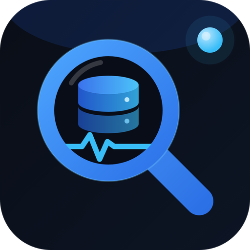
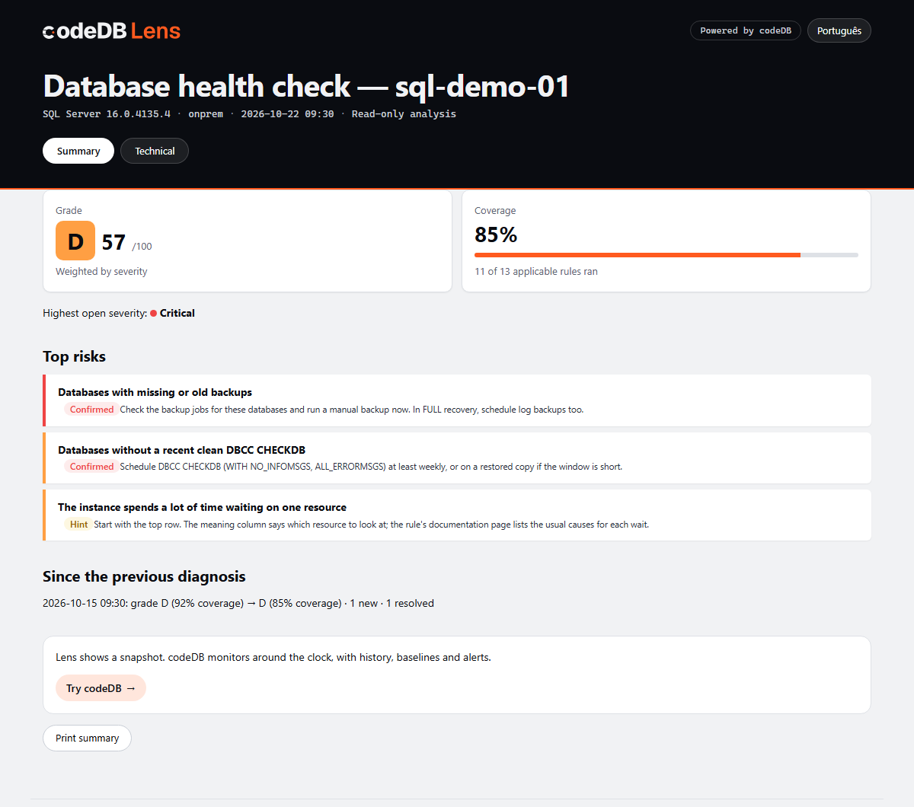

<p align="center">
  
</p>

<h1 align="center">codeDB Lens</h1>

<p align="center">
  <b>Enxergue o que o seu banco não está mostrando.</b><br>
  Diagnóstico gratuito e somente leitura para <b>SQL Server</b> e <b>PostgreSQL</b>.
</p>

<p align="center">
  <a href="https://app.codedb.com.br/lens?utm_source=lens&utm_medium=github">Site</a> · <a href="README.md">English</a> · Português (Brasil)
</p>

<p align="center">
  <a href="https://github.com/codedb-io/codedb-lens/releases/latest"></a>
  <a href="LICENSE"></a>
  
  
  <a href="https://github.com/codedb-io/codedb-lens/actions/workflows/ci.yml"></a>
</p>

<p align="center">
  <a href="https://lens.codedb.com.br/pt-BR/demo/report.html"></a><br>
  <sub>Resumo do relatório (dados de demonstração). <a href="https://lens.codedb.com.br/pt-BR/demo/report.html">Abra o relatório de demonstração completo</a>.</sub>
</p>

---

> **v0.8:** `check` (com resumo executivo e `--redact` para compartilhar), `compare`, e `record` + `report` para acompanhar uma instância por até 24 horas ([como](https://lens.codedb.com.br/pt-BR/record/)). 26 regras e mais 8 para gravações. Perguntas frequentes e mais no [site](https://app.codedb.com.br/lens?utm_source=lens&utm_medium=github).

O codeDB Lens conecta na sua instância com um login **somente leitura**, executa um catálogo de regras
baseadas em evidências e gera um relatório HTML autônomo + JSON com **nota de A a F** e **selo de
cobertura** (quantas regras puderam de fato rodar). Nenhum dado do seu banco sai da sua máquina.

## Instalação

| Onde | Como |
|---|---|
| **Windows** | [Instalador (por usuário, sem admin)](https://github.com/codedb-io/codedb-lens/releases/latest/download/codedb-lens_windows_amd64_setup.exe) ou [.zip portátil](https://github.com/codedb-io/codedb-lens/releases/latest/download/codedb-lens_windows_amd64.zip) |
| **Windows (Scoop)** | `scoop bucket add codedb https://github.com/codedb-io/codedb-lens` e depois `scoop install codedb/codedb-lens` |
| **Linux** | `.deb` / `.rpm` na [última release](https://github.com/codedb-io/codedb-lens/releases/latest), ou o tarball para [x64](https://github.com/codedb-io/codedb-lens/releases/latest/download/codedb-lens_linux_amd64.tar.gz) / [arm64](https://github.com/codedb-io/codedb-lens/releases/latest/download/codedb-lens_linux_arm64.tar.gz) |
| **Docker** | `docker run --rm -e PG_DSN -v "$PWD:/out" ghcr.io/codedb-io/codedb-lens check --engine pg --dsn-env PG_DSN --out /out` |

Os binários do Windows são de código aberto, mas ainda não têm assinatura de código, então o SmartScreen pode mostrar um aviso.
[Por quê, e como verificar o download](https://lens.codedb.com.br/pt-BR/windows-warning/).

## Por que mais uma ferramenta?

- **Evidência, não opinião.** Cada achado mostra os valores coletados, a query de origem e o horário.
- **Confiança honesta.** Cada achado é *Confirmado*, *Indício* ou *Sem dados*. Regra sem permissão
  nunca aparece como falso "OK"; ela reduz a cobertura.
- **Somente leitura, sempre.** Sem DDL, sem DML, sem agente, sem instalar nada no servidor.
- **Regras são dados.** Cada regra é um YAML + uma query SQL. Contribuir não exige mexer no motor.
- **Inglês e português (Brasil)** no app, na linha de comando e no relatório.

## O que verifica

| SQL Server | PostgreSQL |
|---|---|
| Backup ausente ou antigo | Versão fora de suporte |
| Sem DBCC CHECKDB recente e sem erros | pg_stat_statements indisponível |
| Jobs do SQL Agent com falha | Uma consulta dominando o tempo de execução |
| Disco ou log de transações ficando sem espaço | Transações longas e "idle in transaction" |
| Esperas dominantes, traduzidas | Sessões bloqueadas por locks |
| Sessões bloqueadas neste momento | Risco de wraparound de XID |
| Uma consulta dominando a CPU | Linhas mortas e autovacuum ficando para trás |
| Configurações da instância no padrão | Slots de replicação retendo WAL, réplica atrasada |
| Arquivos do TempDB | Conexões perto do limite, sem pooler |
| Versão fora de suporte | Índices não usados, duplicados e inválidos |
| Índices ausentes de alto impacto | Bloat estimado de tabelas |
| Índices não usados e duplicados | Maiores tabelas |

Cada regra tem uma [página de documentação](docs/pt-BR/rules/) com o que verifica, por que importa, o que fazer e seus limites.

## Início rápido

No Windows, abra o **codeDB Lens** pelo menu Iniciar. Escolha o banco, informe o servidor e rode o diagnóstico.
Os perfis de conexão ficam salvos; as senhas vão para o Gerenciador de Credenciais do Windows.

Linha de comando (Windows e Linux):

```bash
codedb-lens check --engine mssql --server prod01 --auth windows
codedb-lens check --engine pg --dsn-env PG_DSN
```

Senhas nunca são aceitas como argumento. Use autenticação integrada, variável de ambiente ou um perfil salvo.

## Permissões mínimas

```sql
-- SQL Server
CREATE LOGIN codedb_lens WITH PASSWORD = '<senha forte>';
GRANT VIEW SERVER STATE TO codedb_lens;
GRANT VIEW ANY DEFINITION TO codedb_lens;
GRANT CONNECT ANY DATABASE TO codedb_lens;   -- regras por banco (índices); não dá acesso a dados
USE msdb;
CREATE USER codedb_lens FOR LOGIN codedb_lens;
ALTER ROLE db_datareader ADD MEMBER codedb_lens;
ALTER ROLE SQLAgentReaderRole ADD MEMBER codedb_lens;
```

```sql
-- PostgreSQL (repita o GRANT CONNECT para cada banco)
CREATE ROLE codedb_lens LOGIN PASSWORD '<senha forte>';
GRANT pg_monitor TO codedb_lens;
GRANT CONNECT ON DATABASE app TO codedb_lens;
```

## Versões suportadas

| Banco | Suportado | Best-effort |
|---|---|---|
| SQL Server | 2017, 2019, 2022, 2025 (Windows e Linux), Azure SQL Managed Instance, Amazon RDS | 2016 e anteriores; Azure SQL Database (6 de 13 regras se aplicam, veja [permissões](docs/pt-BR/permissions.md#azure-sql-database)) |
| PostgreSQL | 15, 16, 17, 18, Amazon RDS, Aurora, Azure Flexible Server | 14 |

## Privacidade

Sem telemetria. O Lens faz dois tipos de chamada de rede: uma verificação de versão opcional, no máximo uma vez por
dia, ao GitHub Releases, sem enviar dados (`--no-update-check` ou `CODEDB_LENS_NO_UPDATE=1` desliga), e, só quando você
pede a chave grátis, um pedido de cadastro com o nome e o e-mail que você digitar (ou, ao renovar, só a chave atual). Veja o [SECURITY.md](SECURITY.md).

## Precisa de monitoramento contínuo?

O Lens mostra um retrato do momento. O [**codeDB**](https://codedb.com.br/?utm_source=lens&utm_medium=github&utm_campaign=readme)
monitora suas instâncias SQL Server e PostgreSQL 24 horas por dia, com histórico, baseline e alertas no Teams, Slack e e-mail.

## Assinatura de código no Windows

Os binários do Windows são gerados pelo GitHub Actions a partir deste repositório e ainda não têm assinatura de código
(os certificados são pagos e este é um projeto gratuito). Detalhes, como verificar um download e alternativas sem aviso:
[Por que o Windows mostra um aviso](https://lens.codedb.com.br/pt-BR/windows-warning/).

## Como contribuir

Novas regras são especialmente bem-vindas. Uma regra é um arquivo YAML mais uma query SQL, sem mexer no código Go:
veja o [CONTRIBUTING.md](CONTRIBUTING.md) ou [abra uma issue](https://github.com/codedb-io/codedb-lens/issues/new/choose) com uma ideia de regra.

## Licença

[Apache 2.0](LICENSE). O codeDB SaaS e sua API são produtos separados e de código fechado.
